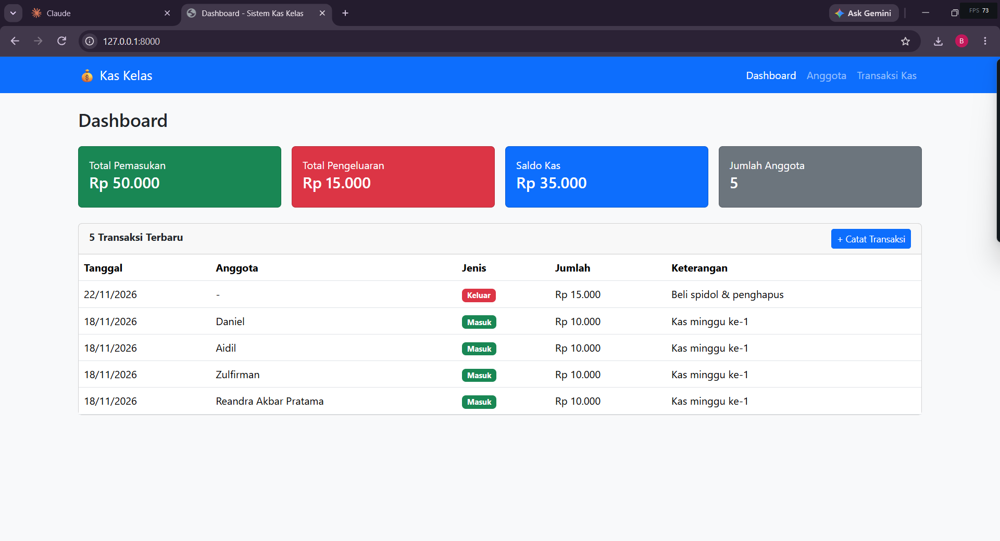
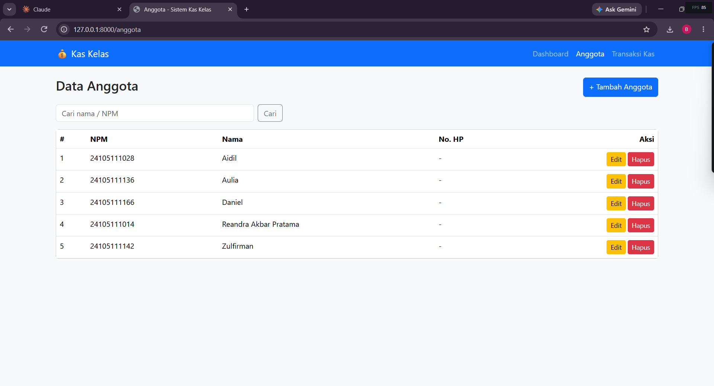
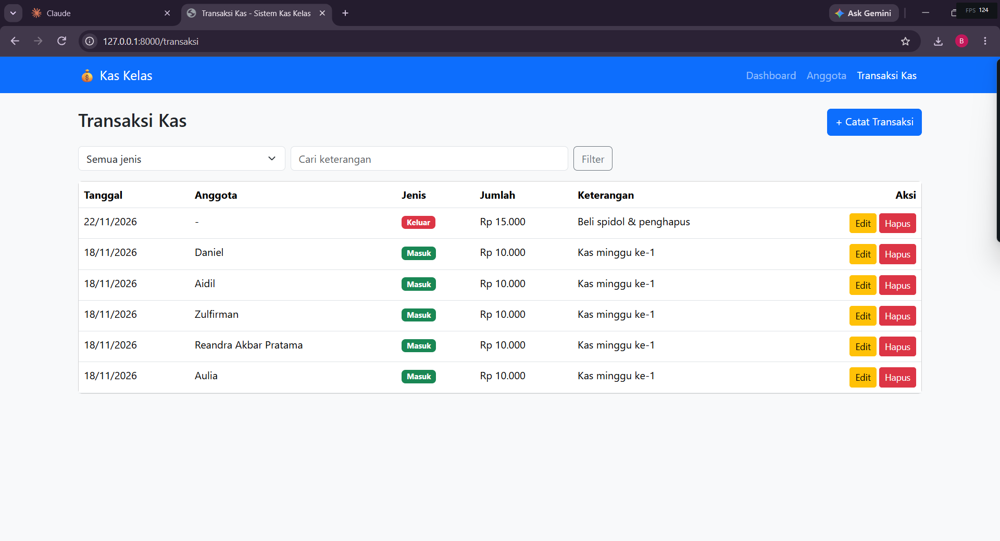

# Sistem Informasi Pengelolaan Kas Kelas Berbasis Web
### Menggunakan Framework Laravel dan Database MySQL dengan Metode CRUD

Tugas Proyek Perangkat Lunak (Framework Laravel) — **Kelompok 5**

**Link Repository:** https://github.com/AuliaSaputra01/Kas-Kelas-Laravel

---

## 1. Anggota Kelompok

| No | Nama | NPM | GitHub | Tugas |
|---|---|---|---|---|
| 1 | Aulia | 24105111136 | [AuliaSaputra01](https://github.com/AuliaSaputra01) | Database (migration, model, seeder) |
| 2 | Reandra Akbar Pratama | 24105111014 | [reandraakbarpratama](https://github.com/reandraakbarpratama?tab=repositories) | Layout & Dashboard |
| 3 | Zulfirman | 24105111142 | [zfmnnn40-boop](https://github.com/zfmnnn40-boop?tab=repositories) | CRUD Anggota |
| 4 | Aidil | 24105111028 | [aidilaceh759-ctrl](https://github.com/aidilaceh759-ctrl?tab=repositories) | CRUD Transaksi Kas |
| 5 | Daniel | 24105111166 | [danielanasalim](https://github.com/85yw8?tab=repositories) | Routing, konfigurasi, dokumentasi, pengujian |

## 2. Latar Belakang
Pencatatan kas kelas secara manual (buku atau chat grup) rawan hilang, salah hitung, dan sulit diperiksa. Aplikasi ini mencatat anggota, pemasukan, dan pengeluaran kas secara terpusat, dengan saldo yang dihitung otomatis.

## 3. Tujuan
Membangun aplikasi web pengelolaan kas kelas menggunakan Laravel dan MySQL dengan menerapkan metode **CRUD** (Create, Read, Update, Delete).

## 4. Fitur
- **Dashboard**: total pemasukan, total pengeluaran, saldo kas, jumlah anggota, dan 5 transaksi terbaru.
- **CRUD Anggota**: NPM (unik), nama, no. HP, dengan pencarian nama/NPM.
- **CRUD Transaksi Kas**: pemasukan/pengeluaran, jumlah, tanggal, keterangan, anggota terkait, dengan filter jenis dan pencarian keterangan.
- Validasi form di sisi server, notifikasi sukses, konfirmasi hapus, dan paginasi.

## 5. Tangkapan Layar

### Dashboard


### Data Anggota


### Transaksi Kas


## 6. Penerapan Metode CRUD

| Operasi | Method Controller | HTTP & Route |
|---|---|---|
| **Create** | `create()`, `store()` | GET `/anggota/create`, POST `/anggota` (sama untuk `/transaksi`) |
| **Read** | `index()` (+ `DashboardController@index`) | GET `/anggota`, GET `/transaksi`, GET `/` |
| **Update** | `edit()`, `update()` | GET `/anggota/{id}/edit`, PUT `/anggota/{id}` |
| **Delete** | `destroy()` | DELETE `/anggota/{id}` |

CRUD diterapkan pada dua entitas (**Anggota** dan **Transaksi**) menggunakan `Route::resource`, Eloquent ORM, dan `$request->validate()`.

## 7. Rancangan Database (MySQL: `kas_kelas`)

**anggotas**

| Kolom | Tipe | Keterangan |
|---|---|---|
| id | bigint (PK) | |
| npm | varchar(20) | unik |
| nama | varchar(255) | |
| no_hp | varchar(20) | boleh kosong |
| created_at, updated_at | timestamp | |

**transaksis**

| Kolom | Tipe | Keterangan |
|---|---|---|
| id | bigint (PK) | |
| anggota_id | bigint (FK) | ke `anggotas.id`, boleh kosong, `nullOnDelete` |
| jenis | enum('masuk','keluar') | |
| jumlah | unsigned bigint | dalam rupiah |
| tanggal | date | |
| keterangan | varchar(255) | boleh kosong |
| created_at, updated_at | timestamp | |

Relasi: satu **Anggota** memiliki banyak **Transaksi** (1 : N).

## 8. Struktur File Utama
```
app/Models/Anggota.php, Transaksi.php
app/Http/Controllers/DashboardController.php, AnggotaController.php, TransaksiController.php
database/migrations/*_create_anggotas_table.php, *_create_transaksis_table.php
database/seeders/DatabaseSeeder.php
resources/views/layouts/app.blade.php, dashboard.blade.php
resources/views/anggota/*, resources/views/transaksi/*
routes/web.php
```

## 9. Teknologi
Laravel 13, PHP 8.3+, MySQL, Bootstrap 5.3 (CDN), Laragon, Git & GitHub.

## 10. Cara Instalasi (Laragon)

```bash
git clone https://github.com/AuliaSaputra01/Kas-Kelas-Laravel.git
cd Kas-Kelas-Laravel
composer install
copy .env.example .env
php artisan key:generate
```

Ubah bagian database di `.env`:
```
DB_CONNECTION=mysql
DB_HOST=127.0.0.1
DB_PORT=3306
DB_DATABASE=kas_kelas
DB_USERNAME=root
DB_PASSWORD=
```

Buat database `kas_kelas` (HeidiSQL/phpMyAdmin), lalu jalankan:
```bash
php artisan migrate --seed
php artisan serve
```
Buka http://127.0.0.1:8000

## 11. Pembagian Kerja & Kontribusi GitHub
Setiap anggota bekerja pada branch sendiri dan melakukan commit dari akun GitHub masing-masing.

| Anggota | File yang dikerjakan |
|---|---|
| Aulia | 2 migration, model `Anggota` & `Transaksi`, `DatabaseSeeder` |
| Reandra Akbar Pratama | `layouts/app.blade.php`, `dashboard.blade.php`, `DashboardController` |
| Zulfirman | `AnggotaController`, `views/anggota/*` |
| Aidil | `TransaksiController`, `views/transaksi/*` |
| Daniel | `routes/web.php`, `AppServiceProvider`, README, pengujian |

## 12. Kesimpulan
Aplikasi kas kelas berjalan dengan baik: data anggota dan transaksi dapat ditambah, dilihat, diubah, dan dihapus, dan saldo kas dihitung otomatis di dashboard. Pengembangan lanjutan yang mungkin: login dan hak akses, laporan PDF/Excel, serta rekap tunggakan per anggota.

## 13. Checklist Tugas

- [x] Membuat aplikasi Laravel sesuai judul
- [x] Membuat database dan fitur CRUD (Anggota dan Transaksi Kas)
- [x] Menerapkan metode CRUD
- [x] Mengunggah source code ke GitHub (isi link repository di bagian atas)
- [ ] Setiap anggota melakukan commit sesuai tugasnya
- [x] Membuat laporan singkat dengan README.md
- [ ] Presentasi dan demo aplikasi
